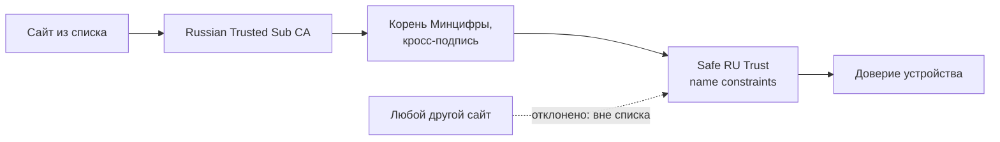

<div align="center">

# Safe RU Trust

**Российские сайты на сертификатах Минцифры открываются, а доверие к корню Минцифры на всё остальное не распространяется.**

[](https://github.com/Maks-gaming/safe-ru-trust/releases/latest)
[](LICENSE)
[](domains.txt)

</div>

---

## Зачем это

Часть российских сайтов (РЖД, банки, госсервисы) перешла на сертификаты Минцифры, и браузер показывает «соединение не защищено». Обычно советуют поставить в систему корень Минцифры, но у него нет ограничений: технически он может подтвердить **любой** сайт, включая почту и мессенджеры.

Safe RU Trust ставит вместо него свой корень, который действует **только на сайты из [domains.txt](domains.txt)**. Работает во всех браузерах устройства.

| | Корень Минцифры | Safe RU Trust |
|---|---|---|
| РЖД, банки и другие сайты из списка | ✅ | ✅ |
| Может подтвердить `google.com`, почту, мессенджеры | ⚠️ да | ✅ нет, браузер отклонит |
| Подделка сертификата на сайт из списка | ⚠️ возможна | ⚠️ возможна |
| Сайт на Минцифре, которого нет в списке | ✅ откроется | ❌ будет ошибка, надо добавить |

> [!IMPORTANT]
> Это ограничение риска, а не полная защита. На сайтах из списка браузер не отличит настоящий сертификат от поддельного, выданного тем же центром. Это также не VPN и не анонимность.

## Установка

### Одной командой

**Windows 10/11**, в PowerShell (сама запросит права администратора):

```powershell
irm https://raw.githubusercontent.com/Maks-gaming/safe-ru-trust/main/windows/get.ps1 | iex
```

**Linux**, без `sudo` (пароль спросит, только если надо доставить certutil):

```sh
curl -fsSL https://raw.githubusercontent.com/Maks-gaming/safe-ru-trust/main/unix/get.sh | sh
```

**macOS** (спросит пароль администратора):

```sh
curl -fsSL https://raw.githubusercontent.com/Maks-gaming/safe-ru-trust/main/unix/get.sh | sh
```

Команды сами скачают последний релиз и включат автообновление. После установки перезапусти браузер.

### Файлами и другие системы

Файлы лежат в [последнем релизе](https://github.com/Maks-gaming/safe-ru-trust/releases/latest).

| Система | Что скачать | Автообновление |
|---|---|---|
| Windows 10/11 | [`safe-ru-trust-windows.zip`](https://github.com/Maks-gaming/safe-ru-trust/releases/latest/download/safe-ru-trust-windows.zip) | ✅ |
| Linux | [`safe-ru-trust-unix.tar.gz`](https://github.com/Maks-gaming/safe-ru-trust/releases/latest/download/safe-ru-trust-unix.tar.gz) | ✅ |
| macOS | [`safe-ru-trust-unix.tar.gz`](https://github.com/Maks-gaming/safe-ru-trust/releases/latest/download/safe-ru-trust-unix.tar.gz) | ✅ |
| iPhone, iPad | [`safe-ru-trust.mobileconfig`](https://github.com/Maks-gaming/safe-ru-trust/releases/latest/download/safe-ru-trust.mobileconfig) | ❌ |
| ChromeOS | [`root.crt`](https://github.com/Maks-gaming/safe-ru-trust/releases/latest/download/safe-ru-trust-root.crt) и [`cross.crt`](https://github.com/Maks-gaming/safe-ru-trust/releases/latest/download/safe-ru-trust-cross.crt) | ❌ |
| Android | Яндекс Браузер, см. ниже | ❌ |

<details>
<summary><b>Windows</b></summary>

Распакуй zip и запусти `install.bat`. Windows спросит права администратора и может предупредить о неизвестном издателе: установщик не подписан. Перезапусти браузер.

Удаление: `uninstall.bat` из той же папки.
</details>

<details>
<summary><b>Linux</b></summary>

```sh
sudo apt install libnss3-tools     # Fedora: nss-tools, Arch: nss
mkdir srt && tar xzf safe-ru-trust-unix.tar.gz -C srt && cd srt
./safe-ru-trust.sh install
```

Перезапусти браузер. `sudo` для самой установки не нужен: сертификаты ставятся в базы браузеров текущего пользователя, включая snap и flatpak. Обновление идёт через пользовательский таймер systemd. Новый профиль браузера подхватится при следующем обновлении.

Удаление: `~/.local/share/safe-ru-trust/safe-ru-trust.sh uninstall`.

Консольные программы (`curl`, `wget`) не покрыты: в их системное хранилище кросс-сертификат класть нельзя, он стал бы доверенным без ограничений.
</details>

<details>
<summary><b>macOS</b></summary>

```sh
mkdir srt && tar xzf safe-ru-trust-unix.tar.gz -C srt && cd srt
sudo ./safe-ru-trust.sh install
```

Удаление: `sudo "/Library/Application Support/SafeRUTrust/safe-ru-trust.sh" uninstall`.
</details>

<details>
<summary><b>iPhone и iPad</b></summary>

1. Открой `safe-ru-trust.mobileconfig` в Safari и разреши загрузку.
2. «Настройки → Профиль загружен → Установить». Предупреждение «не подтверждён» ожидаемо: профиль не подписан.
3. «Основные → Об этом устройстве → Доверие сертификатам» и включи **Safe RU Trust**.

Новую версию ставь так же, она заменит старую. Автоматически обновить профиль iOS без MDM не позволяет.
</details>

<details>
<summary><b>ChromeOS</b></summary>

«Настройки → Конфиденциальность → Управление сертификатами → Центры сертификации → Импорт»:

1. `safe-ru-trust-root.crt`: включи доверие для сайтов.
2. `safe-ru-trust-cross.crt`: **не** включай доверие.
</details>

<details>
<summary><b>Android: на всю систему нельзя, есть обходные пути</b></summary>

Android не даёт поставить промежуточный сертификат: любой CA из настроек становится полностью доверенным, поэтому кросс-сертификат выдал бы корню Минцифры доверие без ограничений. **Не ставь файлы отсюда на Android.**

1. **Яндекс Браузер.** Сам доверяет сертификатам Минцифры, в систему ничего ставить не надо. Самый простой вариант.
2. **Отдельный профиль.** Samsung Secure Folder (Knox) или рабочий профиль (например, через Shelter). Там можно поставить официальный корень Минцифры и держать только российские приложения. Корень работает без ограничений, но только внутри этого профиля, основной профиль его не видит.
</details>

## Как это устроено



- **`safe-ru-trust-root.crt`:** корень с критичным `nameConstraints`. Разрешены домены из списка, все IP-адреса запрещены.
- **`safe-ru-trust-cross.crt`:** корень Минцифры с тем же ключом, переподписанный нашим. Он не становится доверенным сам, а ограничения наследуются по цепочке.
- Сертификаты сайтов не подменяются, трафик никуда не проксируется, сервера у проекта нет.

## Автообновление

Раз в сутки устройство проверяет последний релиз и само заменяет корень, если список изменился. Загруженный код не запускается: обновляются только сертификаты.

Новая версия принимается, только если:

- манифест подписан ключом мейнтейнера, который хранится вне GitHub, а публичная часть зашита при установке;
- номер версии больше текущего и хэши файлов совпадают;
- в корне есть критичные ограничения, запрещены все IP и нет целых зон вроде `ru` или `gov.ru`;
- все домены в `.ru`, `.su`, `.рф` или это один из зафиксированных `.com` из списка, остальное требует новый установщик;
- в кросс-сертификате именно ключ Минцифры.

> [!WARNING]
> Обновления предполагают доверие к мейнтейнеру: при краже ключа подписи и аккаунта можно будет добавить в список российский домен, например почту. Не хочешь этого доверять — отключи задачу `SafeRUTrust update` (на Linux таймер `safe-ru-trust.timer`) и обновляй вручную.

## Проверь сам

```sh
gh release download -R Maks-gaming/safe-ru-trust -D rel
git clone https://github.com/Maks-gaming/safe-ru-trust && cd safe-ru-trust
./verify.sh ../rel/safe-ru-trust-root.crt ../rel/safe-ru-trust-cross.crt
gh attestation verify ../rel/safe-ru-trust-root.crt --repo Maks-gaming/safe-ru-trust
```

- `verify.sh` сверяет ограничения с `domains.txt`, ключ в кросс-сертификате, подпись манифеста и профиль iOS.
- Сборка идёт в публичном GitHub Actions: ключ корня создаётся там и уничтожается в конце, логи и attestation показывают, каким кодом собран файл. Если он всё же утёк, подделать можно только сайты из списка.
- Отпечаток корня Минцифры (совпадает с файлом на gu-st.ru): `D2:6D:2D:02:31:B7:C3:9F:92:CC:73:85:12:BA:54:10:35:19:E4:40:5D:68:B5:BD:70:3E:97:88:CA:8E:CF:31`.

## Добавить сайт

Открой [issue](https://github.com/Maks-gaming/safe-ru-trust/issues) с адресом сайта на сертификате Минцифры. Сайт может подгружать ресурсы с других доменов, их тоже укажи.

---

<sub>Проект не связан с Минцифры и организациями из списка. Без гарантий, используй на свой риск.</sub>
